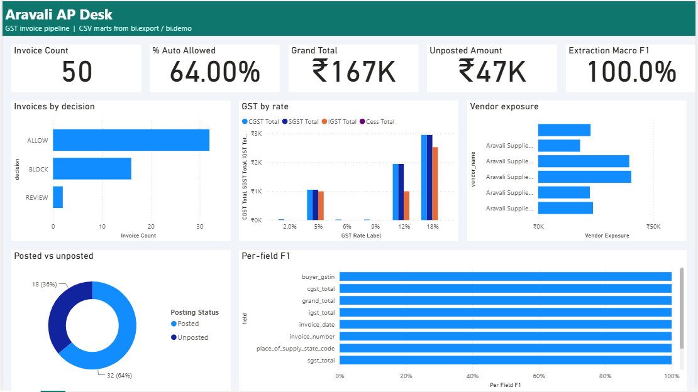
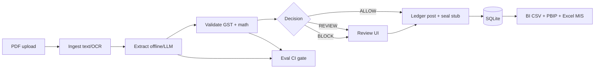

# Aravali AP Desk

Indian GST vendor invoices arrive as scanned PDFs and email attachments. AP teams still key invoice numbers, GSTINs, HSN lines, and CGST/SGST/IGST splits by hand. One wrong GSTIN or tax-regime mismatch blocks input tax credit (ITC); duplicate invoices become double payments; month-end close waits on manual checks.

**Aravali AP Desk** ingests PDFs, extracts structured fields with provenance (page, bounding box, confidence), validates against GST rules and your vendor master, and routes each invoice to **ALLOW**, **REVIEW**, or **BLOCK** before a sealed ledger post, SQLite persistence, and AP dashboards (Power BI + Excel MIS). Offline extraction is the default so CI and demos run without API keys.



## What it does

| Stage | Output |
|-------|--------|
| Ingest | Text layer and optional OCR from PDFs |
| Extract | Header, line items, per-field bboxes (offline rules or optional LLM) |
| Validate | GSTIN, regime, arithmetic, duplicates, vendor master |
| Decide | **ALLOW** / **REVIEW** / **BLOCK** with issue codes |
| Review | Human queue and invoice detail UI with PDF overlay |
| Post | Hash-chained ledger stub receipt + `SealRef` on API response |
| BI | CSV marts, `mis.xlsx`, Power BI PBIP; eval metrics gate in CI |

## Architecture



## Decision policy

Engine outcomes follow `docai/validate/policy.py` (`BLOCK_CODES`, `REVIEW_CODES`, `outcome_from_issues`). No issues → **ALLOW**. Any listed block code → **BLOCK** (block wins over review). Otherwise any review code → **REVIEW**. Unlisted codes still → **REVIEW**.

| Issue code | Outcome |
|------------|---------|
| *(none)* | **ALLOW** |
| `GSTIN_CHECKSUM` | **BLOCK** |
| `GSTIN_STATE_MISMATCH` | **BLOCK** |
| `TAX_REGIME_MISMATCH` | **BLOCK** |
| `DUPLICATE_INVOICE` | **BLOCK** |
| `LINE_ARITHMETIC` | **BLOCK** |
| `TOTAL_MISMATCH` | **BLOCK** |
| `VENDOR_UNKNOWN` | **REVIEW** |
| `ROUND_OFF_EXCEEDED` | **REVIEW** |
| `LOW_CONFIDENCE` | **REVIEW** |
| `MISSING_FIELD` | **REVIEW** |

## Evaluation metrics (offline v1)

Baseline: `evals/baselines/offline-v1.json` (synthetic **n=50**, **seed=7**, scanned ratio **0**). Floors: `evals/thresholds.yaml`. CI runs `python -m evals.gate` against these floors.

| Metric | Achieved | Floor |
|--------|----------|-------|
| Header macro F1 | 1.00 | 0.98 |
| Line-item F1 | 1.00 | 0.98 |
| Bbox IoU@0.5 rate | 1.00 | 0.98 |
| Decision accuracy | 0.90 | 0.87 |

Per-header-field F1 is also **1.00** (floor **0.98**). See [docs/evaluation.md](docs/evaluation.md).

## Quickstart

### One-command dev (API + UI)

**Windows**

```powershell
cd E:\aravali-ap-desk
.\scripts\dev.ps1
```

API: `http://127.0.0.1:8000`. Vite UI: `http://127.0.0.1:5173` (real offline extractor). Seeds `datasets/sample` into `data/ap_desk.db` idempotently.

**Linux / macOS**

```bash
cd aravali-ap-desk
make dev
```

### Tests and eval

```powershell
.\.venv\Scripts\python -m pip install -e ".[dev,eval,synth,ocr]"
.\.venv\Scripts\python -m pytest -q
.\.venv\Scripts\python -m datasets.synth --n 50 --seed 7 --out datasets\generated
make eval
```

Copy `.env.example` to `.env` for optional LLM mode (`EXTRACT_MODE=llm`, `GROQ_API_KEY`).

### BI demo, Power BI, and MIS

```powershell
.\.venv\Scripts\python -m bi.demo --out bi\data
```

Builds `bi/data/demo.db`, CSV marts, and `bi/data/mis.xlsx`. Open `bi/powerbi/AravaliAP.pbip` in Power BI Desktop (PBIP preview), set **DataFolder** to your `bi\data\` path (trailing `\` on Windows), then refresh. Details: [bi/README.md](bi/README.md).

```powershell
.\.venv\Scripts\python -m ledger.verify --db bi\data\demo.db
```

Exit **0** when the hash-chained receipt stub is intact.

## BI and MIS

- **CSV marts** (`invoices`, `line_items`, `issues`, `ledger`, `vendors`, optional `eval_metrics`) via `python -m bi.export`.
- **Excel MIS** (`Summary`, `Aging`, `GST by rate`, `Vendors`, `Exceptions`) via `python -m bi.mis`.
- **Power BI** PBIP semantic model + **AP Overview** report page wired to those CSVs.

### Screenshots

Captured from Power BI Desktop and Excel on the supervisor laptop after M4b verification (50 demo invoices, 64.00% auto-allowed, Rs 167K grand total, Rs 47K unposted, macro F1 100.0%).

| Asset | Description |
|-------|-------------|
| [bi/screenshots/ap-overview.png](bi/screenshots/ap-overview.png) | AP Overview report page (refreshed demo data) |
| [bi/screenshots/powerbi-desktop-ap-overview.png](bi/screenshots/powerbi-desktop-ap-overview.png) | Full Power BI Desktop window |
| [bi/screenshots/mis-summary.png](bi/screenshots/mis-summary.png) | Excel MIS **Summary** sheet |

**To capture:** review queue UI and invoice-detail view with bbox overlay (not in repo yet).

## How it was built: human-controlled multi-agent harness

The **supervisor** (human + automation outside this repo) never writes product code. **Lead** integrates on `main`; worker roles **A–D** edit only paths in `AGENTS.md`. **Cursor hooks** (`preToolUse`, `beforeShellExecution`, fail-closed) enforce scope with rule IDs `AAD-SCOPE-000`–`AAD-SCOPE-005` and `AAD-SHELL-001`–`AAD-SHELL-003`. An independent supervisor scope check and **frozen contracts** after M1 block casual contract drift. Every agent run ends in a **quality gate** (ruff, ruff format, pytest in the worktree venv). **Budgets:** per-run caps (6M SDK-reported tokens, 60 minutes, 400 tool calls; mid-run token **estimate** since 2026-10-26 because usage arrives only at run end—the M3 run hit **16.1M** before that fix), per-day cap **80M** (raised from 40M), max **2** correction rounds per step/role. M2 used **git worktrees** per role, merge-to-main with gate on merged main and rollback on failure. All runs are logged (`logs/runs.jsonl` on the supervisor side).

**M4b:** Real Power BI Desktop verification drove two correction rounds (empty page / bad visual layouts, then DAX and data-path fixes) until all 11 visuals rendered with demo data. See [docs/multi-agent-build.md](docs/multi-agent-build.md).

The **M5** release-prep run (this README and docs) is **not** listed in the harness table below.

| # | Step | Role | Correction | Tokens (SDK) | Tool calls | Minutes | Gate |
|---|------|------|------------|--------------|------------|---------|------|
| 1 | M1 | lead | no | 2,552,137 | 155 | 12.9 | pass |
| 2 | M1 | lead | yes | 2,192,321 | 63 | 6.7 | pass |
| 3 | M1 | lead | yes | 2,355,730 | 34 | 3.7 | pass |
| 4 | M2 | A | no | 2,296,750 | 113 | 18.5 | pass |
| 5 | M2 | B | no | 2,240,020 | 216 | 25.4 | pass |
| 6 | M2 | D | no | 5,049,479 | 182 | 25.7 | pass |
| 7 | M2 | C | no | 2,943,539 | 251 | 29.3 | pass |
| 8 | M2 | B | yes | 1,492,315 | 73 | 18.6 | pass |
| 9 | M2 | D | yes | 1,085,702 | 93 | 30.7 | pass |
| 10 | M2 | D | yes | 809,304 | 22 | 9.0 | pass |
| 11 | M3 | lead | no | 16,109,745 | 315 | 45.9 | skipped (cancelled; over cap) |
| 12 | M3 | lead | yes | 4,009,978 | 41 | 14.3 | pass |
| 13 | M4 | lead | no | ~(est. ~6.06M) | 166 | 23.6 | skipped (cancelled at 166 tool calls) |
| 14 | M4 | lead | no | 2,728,994 | 100 | 32.3 | pass |
| 15 | M4 | lead | yes | n/a | ~7 | ~8 | skipped (owner pause) |
| 16 | M4 | lead | yes | 2,021,917 | 103 | 28.2 | pass |

**Harness totals (rows 1–16, SDK `totalTokens` where reported):** ~47.9M tokens, ~1,934 tool calls, ~333 agent-minutes. SDK total = input + output + cache read (input already includes cache reads, so totals double-count cache for budgeting).

## Milestones

- [x] **M1 — Contracts** — schemas, OpenAPI, hooks, CI, synthetic generator
- [x] **M2 — Pipeline** — ingest, extract, validate, API, ledger, review UI, evals
- [x] **M3 — Integration** — dev scripts, seeded DB, policy + UI on main
- [x] **M4 — Seal + BI + MIS** — verify CLI, CSV/PBIP, Excel MIS, Desktop verification
- [x] **M5 — Release v0.1.0** — docs, changelog, release notes (no product behaviour change)

## Docs

- [docs/architecture.md](docs/architecture.md) — contracts, trust boundaries, ledger stub
- [docs/evaluation.md](docs/evaluation.md) — reproducing evals and CI
- [docs/multi-agent-build.md](docs/multi-agent-build.md) — harness controls and war stories

## License

MIT — see [LICENSE](LICENSE).
